<p align="center"></p>

# Blitz

**Minimum Viable Company kit**

Listen, collect, sprint.  
Reduce cycle time.

Autoscale and quickly launch a minimum viable company or department that can stand up in minimal time.

[Verification workflow](https://github.com/EauDoon/blitz/actions/workflows/verify.yml)

Version **v2.1OAI-r1** · Python **3.12+** · Editable records and local tools

The `main` branch includes later explainer updates, unreleased [customer-discovery and price-testing guidance](Blitz/profiles/customer-discovery.md), [cash scenarios](Blitz/setup/cash-scenarios.md), and [delivery-capacity assessment](Blitz/setup/delivery-capacity.md). The tagged release and its downloadable assets remain the original published snapshot; use a current source checkout for these later tools.

The discovery update has [100 frozen behavioral cases](tests/evals/customer-discovery/README.md). Use the [versioned scoring corrections](tests/evals/customer-discovery-scoring-v3/README.md) with those unchanged tasks; case authoring and static checks alone do not establish a successful behavioral run.

Frame → Test → Deliver → Operate. [Static illustration](docs/assets/blitz-motion-poster.svg).

[Start](#first-use) · [Outputs](#what-you-can-make) · [Run a cycle](#run-a-cycle) · [25 skills](#using-the-skills) · [Verification](#verification) · [Rights](#rights-and-distribution)

Blitz helps founders and small teams establish a **minimum viable company (MVC) or department**. It connects an initial idea to a bounded offer or internal service, evidence, delivery and an accountable owner. Work directly with an editor and the records, or give an LLM the relevant guides, readable records and appropriate tools.

Aim to demonstrate one company or department operating cycle and establish a feasible next one. Target **one or two days** when scope, people, inputs and permissions allow. Actual delivery, acceptance and funding or resource evidence determine readiness; longer external cycles take longer. A folder, prototype, incorporation or business plan alone cannot demonstrate operation. Blitz does not guarantee annual recurring revenue (ARR), repeat demand, profitability or product-market fit.

Here, **autoscale** means make the process repeatable and expand when evidence, capacity and authority support the next commitment. The kit does not deploy technical autoscaling or run autonomous operations. The launch target neither guarantees an outcome nor permits skipping a gate.

## Who it is for

Use Blitz when you are:

- A founder turning a customer problem into one testable offer.
- A department lead turning a stakeholder need into an agreed internal service or result.
- An operator checking whether delivery, funding, resources and the next cycle fit together.
- A small team consolidating scattered evidence, responsibilities and decisions.

Start with one accountable owner, one offer or internal service, and one workstream. For a department, name the users, accepting stakeholder and sponsor who can authorize its budget and resources. Add a document, specialist or tool when the work needs it.

This repository supplies a workflow and utilities. It does not host your business, install autonomous agents, schedule background work, form entities, send outreach, move money or determine legal compliance. A small request can remain a small request; you do not need to complete every template.

## What you can make

For a first workflow, choose one useful result. These requests are illustrative, not preconfigured automations or demonstrated customer results:

- **Prepared proposal:** turn a supplied need, bounded offer and supported costs into a draft scope, acceptance criteria and decision for the owner.
- **Follow-up awaiting approval:** turn authorized call notes into exact draft text, separating stated commitments from open questions; the human approves it before sending.
- **Sourced call brief:** use the call's purpose and permitted sources to prepare known facts, source dates, uncertainties and questions.
- **Short weekly review:** use current delivery, decision and cash or resource records to show changes, blockers and the next decision; unsupported inputs stay unknown.

The [skills guide](Blitz/setup/skills-guide.md#from-outcome-to-method) maps these outcomes to packaged methods and prerequisites. Start with one result; a proposal does not require a deck, website or full set of records. The kit's building blocks support the work:

| Output | How you produce it | What it is for |
|---|---|---|
| Company or department brief | Adapt the generated `company-brief.md`, its template or existing records | Define customer/user, payer or accountable sponsor, offer/service, owner, constraints and next experiment |
| Evidence and decision record | Maintain the four generated `context/` files | Separate adopted positions, unresolved questions and consequential decisions |
| Cash forecast or resource plan | Use the cash command for its commercial cash schema; use the capacity command for delivery hours and existing budget records for funding | Inspect collection timing, cash floors, shared-resource bottlenecks, due periods and work dependencies |
| Experiment or delivery record | Use the brief and relevant existing records | Fix criteria, save actual observations and decide the next commitment |
| Specialist work product | Select a relevant packaged skill | Draft a research memo, proposal, workbook, diagram, presentation or review; dependencies vary |
| Scoped handoff | Use the CSV scope or item-export tools | Share selected material with provenance and a clear authority boundary |

The starter creates drafts with company-oriented fields. You adapt them, supply evidence, adopt decisions and approve commitments. It does not allocate a department's budget or staff. Each skill also needs the inputs and tools specified in its guide.

## First use

Set up one narrow useful workflow in this order:

1. **Give it business context.** Name the customer or internal user, offer or service, owner, current evidence and constraints. Use authorized source files; scattered chat memory is not a business record.
2. **Write a short operating brief.** State the first useful outcome, where to save it, what good looks like, and what the human owns. Existing records or the [commission brief](Blitz/templates/commission-brief.md) are enough.
3. **Check available tools.** Use readable files first. If the task needs a connector, confirm the chosen host can read the permitted source and record the allowed actions. Connectors, costs and scheduling depend on the host, plan and authorized tools. Permission to read is not permission to send, charge, delete, commit changes or agree to terms.
4. **Run once, then decide what should recur.** Inspect the saved output and its sources. A weekly review can begin as a manual request. Selecting a skill does not create a schedule; a recurring run needs a separately configured, authorized host facility.

The human owns goals, terms and consequential commitments. AI can prepare proposals, follow-ups and recommendations for approval, and execute explicitly permitted steps such as reading scoped records, calculating supplied inputs or saving a draft to the named folder. Broader action needs a narrower definition than “run the business.” [START](Blitz/START.md#decide-what-the-assistant-may-do) explains how to test and bound it.

**[Download the v2.1OAI-r1 master](https://github.com/EauDoon/blitz/releases/download/v2.1OAI-r1/Blitz_v2.1OAI-r1.zip)** from the [release and checksums](https://github.com/EauDoon/blitz/releases/tag/v2.1OAI-r1), verify its digest, extract it, and open **[Blitz/START.md](Blitz/START.md)**. That single entry offers company and department routes, a small reading set and an explicit-source assistant prompt. Runtime generation, staging and all 25 methods are optional.

For source development, use the same tagged version:

```sh
git clone --branch v2.1OAI-r1 https://github.com/EauDoon/blitz.git
cd blitz
```

The commands below work from the parent of `Blitz/` in either the extracted master or a repository checkout. The [release guide](Blitz/setup/release-guide.md) includes the detailed offline instructions. Keep filled company records outside reusable source.

Use **Python 3.12 or later**. The setup, calculation and packaging helpers use the standard library; no package installation is needed for this exercise. Commands that create a directory (`company.py init`, `scope_csv.py create` and the release build) publish it with an atomic no-replace rename that supports **Windows and Linux only**. On another platform, macOS included, they stop with a handled error and write nothing; follow [Working without the CLI](#working-without-the-cli) there. The read-only `cash`, `stress` and `capacity` calculations do not publish a directory. Examples use `python`; substitute your verified Python 3 command where necessary. Run commands from the repository root.

### 1. Verify and create a practice workspace

Run these commands for a fictional company:

```sh
python -B Blitz/setup/verify_kit.py
python -B -c "from pathlib import Path; Path('.work').mkdir(exist_ok=True)"
python -B Blitz/setup/company.py init --out .work/my-company --name "My company" --owner "Example founder"
```

Initialization emits a JSON receipt and creates seven draft files:

```text
.work/my-company/
  README.md
  company-brief.md
  company-cash.csv
  context/
    00 Read Me First.md
    03 Position Of Record.md
    09 Open Questions.md
    10 Decision Log.md
```

Output directories must be **new**, their parents must exist, and initialization must stay outside the `Blitz/` source kit. Occupied targets are rejected. So is any input or output path with a `.` or `..` component: write `Blitz/examples/company/service-cash.csv`, not `./Blitz/examples/company/service-cash.csv`. Reuse `.work` but choose a new company directory for another initialization. The practice folder is ignored by Git. Keep real company or department records outside this source repository, using an explicit absolute output path.

### 2. Frame the first experiment

Open the generated brief. Name the customer and payer, bounded offer, initial sales route, minimum delivery requirements, hardest assumption and next permitted experiment. Set success, change and stop criteria before observing the result.

For a department, adapt the prompts to internal users, an accountable sponsor, agreed service, intake route, authorized budget and available people. The initializer uses company names and defaults record 00 to `venture`. Revise that unadopted draft to the actual unit type before use.

Keep adopted positions in `03`, missing evidence in `09` and consequential decisions in `10`. Keep one canonical writer.

### 3. Check the cash inputs

Calculate the blank cash template to see how missing inputs behave:

```sh
python -B Blitz/setup/company.py cash .work/my-company/company-cash.csv
```

This intentionally reports **incomplete**, with exit code **2**. Fill supported values and label their sources and assumptions in the brief; enter `0` only when zero is known. Run the complete fictional example next:

```sh
python -B Blitz/setup/company.py cash Blitz/examples/company/service-cash.csv
```

For a department, keep allocations, commitments, actual spend and capacity in suitable resource records or the [Economics and Budget template][department-budget]. An approved budget is not earned revenue or collected cash; do not put it into the commercial cash CSV. The `company` filenames and commands remain compatibility names.

### Working without the CLI

Copy the [company brief](Blitz/templates/company-brief.md) and [cash template](Blitz/templates/company-cash.csv), or use sufficient existing records. The [company and department guide](Blitz/profiles/company.md) and [first-user walkthrough](docs/FIRST_USER.md) explain the next steps.

## Workflow

The same gates apply to a company or department. The table below gives the evidence for each.

<picture>
  <source media="(max-width: 820px)" srcset="docs/assets/workflow-mobile.svg">
  
</picture>

The four gates describe **operating evidence**, with thresholds proportionate to the next commitment's risk:

| Gate | What you establish | Useful evidence |
|---|---|---|
| **Frame** | A customer/user, payer or accountable sponsor, problem, bounded offer/service, owner and permitted test | Observed need, price or authorized resources, scope, acceptance criteria, time and cash/budget cap |
| **Test** | Whether the hardest assumption survives an actual experiment | Customer or user behavior against predeclared criteria; distinguish interest from orders, committed resources or actual use |
| **Deliver** | Whether the promised result was delivered and accepted | Actual output, acceptance by the named customer or internal stakeholder, costs, support and failure/remedy route |
| **Operate** | Whether exchange or resource use is reconciled and the next cycle is feasible | Commercial receipts, obligations and cash timing; or authorized budget, actual spend and resource use; capacity, owner and repeatable procedure for either |

Record **Proceed, Hold or Walk** for the specific next commitment. A Hold pauses the dependent action while useful authorized work continues. Advancing a gate does not grant permission to spend, sign, publish or contact anyone.

The [playbook](Blitz/PLAYBOOK.md) has separate, optional work stages: Ingestion, Firming, Mandate, Blitzing and Delivering. The launch target does not change their pilot timing or impose a readiness deadline. A prepared experiment, a demonstrated operating cycle and demonstrated repetition are different claims.

## Run a cycle

Use the [synthetic service example](Blitz/examples/company/service-example.md) to practise these steps. Real work needs its own evidence and authority.

1. **Frame one offer or internal service.** Fill the brief with the customer/user, payer or sponsor, result, price or authorized resources, scope and owner. Identify the hardest assumption. Set the next experiment's success, change and stop criteria, with a time and cash/budget cap.
2. **Test that assumption.** Conduct only the permitted experiment. Save observations and source dates. Separate interest, commercial orders/payment, internal resource commitments, actual use and accepted delivery. Record missing evidence in `09 Open Questions.md`.
3. **Decide the next commitment.** Compare the result with the criteria. Record Proceed, Hold or Walk, its basis and owner in `10 Decision Log.md`. Adopt an actual position in `03 Position Of Record.md`; do not turn an unapproved draft into one.
4. **Deliver within the agreed scope.** Retain the promised result, acceptance evidence, actual costs and failure/remedy route, including refunds where applicable. A completed artifact alone does not establish acceptance by the named customer or internal stakeholder.
5. **Check the next operating cycle.** Reconcile collections and obligations for a commercial offer, or actual spend and resource use against the department's authorized budget and capacity. Update the appropriate forecast and delivery procedure. A complete calculation can still show a shortfall. Decide whether the next cycle is feasible.
6. **Leave recoverable work.** Update `00 Read Me First.md` with the governing records, owner and next permitted action. Close and reopen the records. Another session should recover the position and authority boundary without relying on chat memory.

Move back to the affected gate when evidence changes. Keep the record proportionate: a useful existing document can replace another template. For a department, one accepted internal request and an evidenced, resourced next cycle can demonstrate the bounded operating baseline; it does not establish external sales or paid demand.

To work with an assistant, first give it readable access to the kit and a scoped practice folder. A starting request is:

> Read `Blitz/README.md` and `Blitz/profiles/company.md`. Help me frame a fictional fixed-scope reporting service. Produce one draft offer and the smallest useful test. Label assumptions, specify the evidence to collect, and leave consequential actions for human approval. Use a relevant packaged method only when needed, and identify what you read.

Then ask it to review supplied experiment evidence, prepare a delivery checklist or inspect your saved handoff. Confirm the actual files and calculations. Do not treat its completion claim as evidence that an external action happened.

## Worked example

The [synthetic reporting service](Blitz/examples/company/service-example.md) sells one fixed-scope CSV cleanup for **USD 600**. Its supplied fixture includes the incoming inquiry, order, input/output, acceptance and payment. Everything is fictional; the example demonstrates the method, not real customer demand.

Each job incurs USD 78 of variable cost and six founder hours. Contribution is **USD 522**, or **87%**, before fixed costs, tax and unpaid founder labor. The cash schedule makes collection timing visible:

| Monthly period | Earned revenue | Cash collected | Closing cash |
|---|---:|---:|---:|
| 1 | USD 600 | USD 600 | USD 2,072 |
| 2 | USD 600 | USD 0 | USD 1,744 |
| 3 | USD 600 | USD 1,200 | USD 2,516 |

If Period 3 collections slip beyond the forecast horizon, its closing cash falls to **USD 1,316**, **USD 184 below** the founder's USD 1,500 floor. Positive contribution does not remove that funding problem. Read the example for all costs, assumptions and the next-cycle procedure.

The [regulated-activity example](Blitz/examples/company/regulated-hold.md) shows a different result: an options memo and simulation can be complete while a proposed customer-funds activity remains on Hold.

## Using the skills

The kit contains **25 method packages**. The [skills guide](Blitz/setup/skills-guide.md#all-25-packaged-skills) lists every method, its purpose, a fictional example request, expected output and dependencies. Pick a method for a concrete task; you do not need all 25 for every company or department.

Each package supplies reusable instructions and supporting resources for a kind of work. Choose the outcome first, then a method to help produce it.

| Your task | Start with | Typical output |
|---|---|---|
| Investigate an offer or compare options | `research-protocol`, `reasoning-core` | Sourced findings, assumptions and a decision basis |
| Make the economics inspectable | `calc-workbook` | An editable calculation workbook, when spreadsheet tools are available |
| Explain or present the work | `my-writing-style`, `diagram-design`, `slide-design` | A draft, diagram or presentation suited to its audience |
| Build a focused web surface | `frontend-taste`, `frontend-mockup`, `frontend-scroll-craft` | Design direction, a mockup or implementation, depending on tools and scope |
| Check a consequential artifact | [gauntlet-verify](https://github.com/EauDoon/gauntlet-verify) | Independent findings and a bounded review result when its review mechanism is available |

### Do they trigger automatically?

**Sometimes, on a host that has discovered the skill. Cloning this repository does not install the methods.**

- **Source use:** ask the assistant to read the relevant `Blitz/skills/<name>/SKILL.md` and its applicable resources. This works only when it can access those files. It is an explicit source workflow.
- **Reference staging or Blitz runtime:** the setup tools prepare files and a method index for a host. They do not register native skills. The operator must make those sources available and confirm they can be read.
- **Native host use:** separately install or expose selected methods using that host's supported route, after checking names, existing skills and dependencies. Confirm the host lists the intended version before testing selection.
- **Claude Code project skills:** `.claude/skills/` lists the methods named in `tools/claude_skills.json` as project skills when Claude Code works in this checkout or in a Claude project with this repository attached. The committed list holds `blitz` and `website-cloner`. Add a method only when your Claude account has no skill for it: each entry adds its description to every session's skill listing, and a second copy competes with your own. Each entry carries the method's name and description and points to `Blitz/skills/<name>/`, which remains the only copy. Nothing is installed in a user account, and a listed skill does not prove that the host selected or ran it.

Each packaged method has a frontmatter description, and all 25 `agents/openai.yaml` files permit implicit invocation. These describe intended selection; they cannot guarantee that a host discovers or chooses the skill. OpenAI documents explicit selection as well as description-based matching. See the [current skill documentation](https://learn.chatgpt.com/docs/build-skills), checked 11 October 2026.

If automatic selection misses, use the host's skill picker or explicit invocation. If it is not installed, request the source directly:

> Read `Blitz/skills/research-protocol/SKILL.md` and its applicable references. Apply it to this fictional customer-research question. State which files you could read and which evidence remains missing.

Staged OpenAI reference names include `calculation-workbook` for `calc-workbook` and `web-design-taste` for `frontend-taste`. `google-slides` requires a host capability check and is skipped by that staging tool. See the [setup and selection guide](Blitz/setup/skills-guide.md) before relying on aliases or tools.

This release makes no measured automatic-selection claim for Blitz. Package validation, a metadata flag and tests of separately installed personal skills cannot establish Blitz's routing reliability. Verify selection in your actual host and retain the explicit fallback.

### Compare cash scenarios

Run `python -B Blitz/setup/company.py stress Blitz/examples/company/service-cash.csv --scenarios Blitz/examples/company/cash-scenarios.json` to compare the synthetic baseline with delayed collections, cash-cost increases and a combined downside. The read-only report shows period calculations, ending-cash differences, deferred receipts and closing reserve gaps. [Scenario guide](Blitz/setup/cash-scenarios.md) documents assumptions and missing-input behavior.

### Check delivery capacity

Run `python -B Blitz/setup/company.py capacity Blitz/examples/company/delivery-plan.json` to assess a supplied multi-resource plan for a venture or department. The synthetic example exposes 3 excess analyst hours in Week 2 and a delivery planned after its due period. The report checks all shared-resource loads, required effort, due periods and finish-to-start dependencies; missing capacity or effort remains unknown. Inputs stay unchanged. Read the [capacity guide](Blitz/setup/delivery-capacity.md) for the schema and assumptions. A complete calculation can report conflicts, and a plan within supplied limits still needs evidence, acceptance and authority.

## Tools and contents

| Location | Purpose |
|---|---|
| [Company and department profile](Blitz/profiles/company.md) | Launch workflow, evidence gates, roles, economics/resources and scoped jurisdiction questions |
| [Templates](Blitz/templates/) | Editable brief, cash inputs and working records; create only what is useful |
| [25 method packages](Blitz/setup/skills-guide.md) | Research, reasoning, writing, economics, design, building and review methods with their resources and notices |
| [Setup tools](Blitz/setup/) | Local company initialization/calculation, CSV scoping, archive verification and item export |
| [Runtime guide](Blitz/setup/runtime.md) | Optional 17-file Blitz-compatible source set and resource archive; generation does not install anything |
| [Examples](Blitz/examples/company/), [evaluations](Blitz/evals/) and [tests](tests/) | Synthetic demonstrations and builder checks, separate from runtime context |
| [Verification](docs/VERIFICATION.md), [migration](docs/MIGRATION.md) and [changelog](Blitz/CHANGELOG.md) | Check contracts, upgrade boundaries and release history |

The cash command emits JSON. **0** means a complete calculation, even if it reports a shortfall; **2** means incomplete inputs; **1** means invalid input or another handled error. It preserves supplied period order, requires one currency per forecast, and distinguishes earned revenue from collections. It checks closing balances, not cash movements within each period, and does not extrapolate runway beyond the supplied horizon.

For a shared CSV, the scope utility selects exact rows and named columns. After the first-use setup, this runnable example keeps only Period 1 and three columns from the verified synthetic source:

```sh
python -B Blitz/setup/scope_csv.py create --source Blitz/examples/company/service-cash.csv --output .work/period-1 --expected-sha256 1c7d3b6a645f3d8b4534144c50b0d9eee07c67bce5d0266ebc232bd3a9b65ecc --source-revision v2.1OAI-r1 --item-column period --item-id "Period 1" --column period --column currency --column earned_revenue
```

It writes `projected.csv` and `provenance.json`, with source, filter and hash evidence. The pinned hash belongs to this exact example. Use a separately trusted source hash for other inputs and retain the returned receipt hash for inspection. `python -B Blitz/setup/scope_csv.py inspect --help` shows the verification interface. A projection and matching hash do not establish that arbitrary cell content is appropriate to disclose.

Selected methods may need external libraries, document renderers, fonts, browsers, connectors or host tools. These are not bundled or granted. Check the method's actual dependencies before use. Source availability does not establish native installation, automatic routing or execution on your host.

## Privacy and authority

Keep credentials, real customer or employee records, private terms and company/department instances out of tracked files. Use explicit allowlists for exports, inspect their actual contents, and follow the [item-export contract](Blitz/setup/item-export.md). A private filename is a label, not access control.

Evidence informs decisions; a human owns consequential commitments. Company formation, contracts, spending, outreach, account changes and deployment require applicable authority. Activity and jurisdiction determine which legal, tax, licensing, data and insurance questions need current evidence or qualified review. A founder's or sponsor's approval cannot supply a missing permission. Interrupted external actions must be reconciled before retrying.

## Verification

From the repository root, use new output directories for each run:

```sh
python -B -c "from pathlib import Path; [Path(p).mkdir(exist_ok=True) for p in ('.verification', '.dist')]"
python -B Blitz/setup/verify_kit.py
python -B Blitz/evals/run_all.py --kit Blitz --out .verification/readme-check
python -B -m unittest discover -s tests -p "test_*.py" -v
python -B tools/release.py build --out .dist/readme-release
python -B tools/check_publication.py
```

The build produces the versioned master ZIP, runtime source set and `release-manifest.json`. The master contains a self-contained [release guide](Blitz/setup/release-guide.md) for archive users; repository-only CI and release tooling remain in this checkout. It does not publish or install them. The [CI workflow](.github/workflows/verify.yml) runs kit, regression, publication and packaging checks on Linux. Read the [verification contract](docs/VERIFICATION.md) for what each result establishes. Passing checks proves their stated behavior and file identities, not business success or universal disclosure safety.

## Contributing

Propose a concrete user problem and the smallest change that addresses it. Follow [repository instructions](AGENTS.md), preserve useful existing interfaces and method notices, and keep examples independently synthetic. Include affected checks and actual results with the change. Do not attach real company, departmental or employee data, or credentials, to an issue, pull request or fixture. A method or document should earn its place through a task, dependency or demonstrated failure.

## Rights and distribution

This edition carries component-specific license and attribution notices, plus original generic symbols in place of product logos. Public distribution uses a reviewed source snapshot with fresh Git history; earlier development history and source originals remain private. Read the [rights audit](docs/PUBLICATION_AUDIT.md) and [publication record](docs/PUBLICATION_PLAN.md). Original Blitz material now uses the custom [Blitz Internal Use License 1.0](LICENSE): individuals and startups with **fewer than 100 employees OR valuation below US$50 million** may use it internally for free with attribution. Other organizations need written permission at [daniel@danieloon.ai](mailto:daniel@danieloon.ai). Providing the covered package or its functionality as third-party services or consulting is prohibited. Third-party and previously licensed material retain their existing rights. Read the [licensing guide and scope](docs/LICENSING.md). These are source-available terms, not an open-source license.

Blitz derives from the v2OAI package; this edition preserves its method identities and reviewed mechanisms while replacing private material with reusable guidance and synthetic fixtures. Read [rights and provenance](docs/PROVENANCE.md) and the applicable component notices before redistribution. Publication checks are bounded checks of reviewed content and history, not clearance for arbitrary future inputs.

[department-budget]: Blitz/templates/context/04%20Economics%20And%20Budget.md
