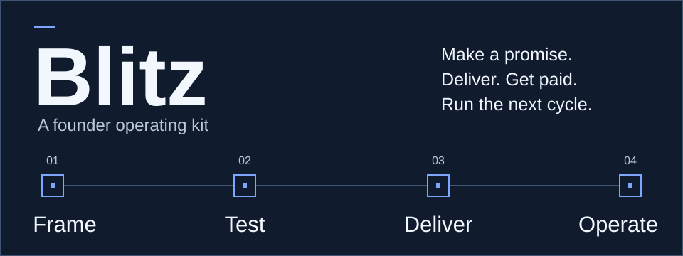
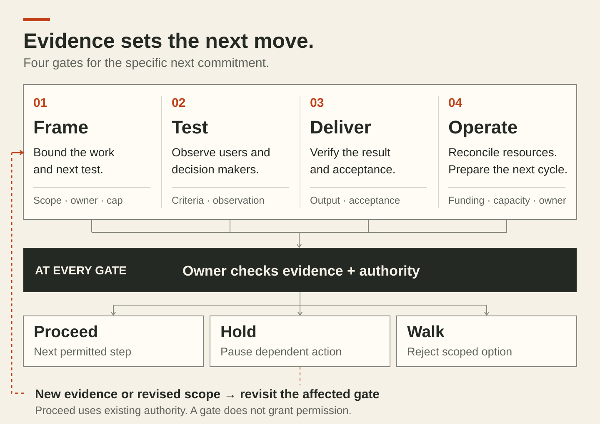

<picture>
  <source media="(prefers-reduced-motion: no-preference)" srcset="docs/assets/blitz-motion.gif">
  
</picture>

# Blitz

**Build the smallest company that can make a promise, deliver it, get paid and run the next cycle.**

[Verification workflow](https://github.com/EauDoon/blitz/actions/workflows/verify.yml)

Version **v2.1OAI** · Python **3.12+** · Editable records and local tools

Frame → Test → Deliver → Operate. [Static illustration](docs/assets/blitz-motion-poster.svg).

[First use](#first-use) · [Workflow](#workflow) · [Worked example](#worked-example) · [Tools and contents](#tools-and-contents) · [Verification](#verification) · [Rights and distribution](#rights-and-distribution)

Blitz is an operating kit for founders and small teams building a **minimum viable company**. It connects the offer, customer evidence, delivery, cash and decision owner in one manageable process. Use it with an editor and a human operator, or give the relevant guide and records to an assistant with appropriate tools.

The aim is a demonstrated customer cycle and a feasible next one. A generated folder, prototype, incorporation or polished business plan is useful preparation; none establishes that a business can operate. One successful cycle also does not establish repeat demand, profitability or product-market fit.

## Who it is for

Blitz suits a founder testing a narrow offer, an operator making delivery repeatable, or a small team bringing scattered decisions and evidence into one working record. Start with one owner, one offer and one workstream. Add a document, specialist or tool when the work needs it.

This repository supplies a workflow and utilities. It does not host your business, install autonomous agents, schedule background work, form entities, send outreach, move money or determine legal compliance. A small request can remain a small request; you do not need to complete every template.

## First use

Use **Python 3.12 or later**. The setup, calculation and packaging helpers use the standard library; no package installation is needed for this exercise. Examples use `python`; substitute your verified Python 3 command where necessary. Run commands from the repository root.

First verify the kit and create a fictional practice workspace:

```sh
python -B Blitz/setup/verify_kit.py
python -B -c "from pathlib import Path; Path('.work').mkdir(exist_ok=True)"
python -B Blitz/setup/company.py init --out .work/my-company --name "My company" --owner "Example founder"
```

Initialization emits a JSON receipt and creates seven draft files:

```text
.work/my-company/
  README.md
  company-brief.md
  company-cash.csv
  context/
    00 Read Me First.md
    03 Position Of Record.md
    09 Open Questions.md
    10 Decision Log.md
```

Open the generated brief. Name the customer and payer, bounded offer, initial sales route, minimum delivery requirements, hardest assumption and next permitted experiment. Fix its success, change and stop criteria before observing the result. Use `03` for an actually adopted position, `09` for missing evidence and `10` for consequential decisions. Keep one canonical writer.

Calculate the blank cash template to see how missing inputs behave:

```sh
python -B Blitz/setup/company.py cash .work/my-company/company-cash.csv
```

This intentionally reports **incomplete**, with exit code **2**. Fill supported values and label their sources and assumptions in the brief; enter `0` only when zero is known. Run the complete fictional example next:

```sh
python -B Blitz/setup/company.py cash Blitz/examples/company/service-cash.csv
```

Output directories must be **new**, their parents must exist, and initialization must stay outside the `Blitz/` source kit. Occupied targets and paths containing `..` are rejected. Reuse `.work` but choose a new company directory on another initialization. The practice folder is ignored by Git. Keep real company records outside this source repository, using an explicit absolute output path.

Prefer working manually? Copy the [company brief](Blitz/templates/company-brief.md) and [cash template](Blitz/templates/company-cash.csv), or use sufficient existing records. The [company guide](Blitz/profiles/company.md) and [first-user walkthrough](docs/FIRST_USER.md) explain the next steps without requiring the CLI.

## Workflow

<picture>
  <source media="(max-width: 820px)" srcset="docs/assets/workflow-mobile.svg">
  
</picture>

The four gates describe **business evidence**, with thresholds proportionate to the next commitment's risk:

| Gate | What you establish | Useful evidence |
|---|---|---|
| **Frame** | A customer, payer, problem, bounded offer, accountable owner and permitted test | Observed problem, clear price/scope, acceptance criteria, time and cash cap |
| **Test** | Whether the hardest assumption survives an actual experiment | Customer behavior against predeclared criteria; distinguish interest, orders and payment |
| **Deliver** | Whether the promised result was delivered and accepted | Actual output, customer acceptance, delivery costs, support and failure/refund route |
| **Operate** | Whether the exchange is reconciled and the next cycle is feasible | Receipts, obligations, contribution, cash timing, capacity, owner and repeatable procedure |

Record **Proceed, Hold or Walk** for the specific next commitment. A Hold pauses the dependent action while useful authorized work continues. Advancing a gate does not grant permission to spend, sign, publish or contact anyone.

These gates are separate from the optional work stages in the [playbook](Blitz/PLAYBOOK.md): Ingestion, Firming, Mandate, Blitzing and Delivering. There is no mandatory 72-hour company deadline. A prepared experiment, a demonstrated MVC and demonstrated repetition are different claims.

## Worked example

The [synthetic reporting service](Blitz/examples/company/service-example.md) sells one fixed-scope CSV cleanup for **USD 600**. Its supplied fixture includes the incoming inquiry, order, input/output, acceptance and payment. Everything is fictional; the example demonstrates the method, not real customer demand.

Each job incurs USD 78 of variable cost and six founder hours. Contribution is **USD 522**, or **87%**, before fixed costs, tax and unpaid founder labor. The cash schedule makes collection timing visible:

| Monthly period | Earned revenue | Cash collected | Closing cash |
|---|---:|---:|---:|
| 1 | USD 600 | USD 600 | USD 2,072 |
| 2 | USD 600 | USD 0 | USD 1,744 |
| 3 | USD 600 | USD 1,200 | USD 2,516 |

If Period 3 collections slip beyond the forecast horizon, its closing cash falls to **USD 1,316**, **USD 184 below** the founder's USD 1,500 floor. Positive contribution does not remove that funding problem. Read the example for all costs, assumptions and the next-cycle procedure.

The [regulated-activity example](Blitz/examples/company/regulated-hold.md) shows a different result: an options memo and simulation can be complete while a proposed customer-funds activity remains on Hold.

## Tools and contents

| Location | Purpose |
|---|---|
| [Company profile](Blitz/profiles/company.md) | Founder workflow, evidence gates, roles, economics and scoped jurisdiction questions |
| [Templates](Blitz/templates/) | Editable brief, cash inputs and working records; create only what is useful |
| [25 method packages](Blitz/skills/README.md) | Research, reasoning, writing, economics, design, building and review methods with their resources and notices |
| [Setup tools](Blitz/setup/) | Local company initialization/calculation, CSV scoping, archive verification and item export |
| [Runtime guide](Blitz/setup/runtime.md) | Optional 17-file Thor-compatible source set and resource archive; generation does not install anything |
| [Examples](Blitz/examples/company/), [evaluations](Blitz/evals/) and [tests](tests/) | Synthetic demonstrations and builder checks, separate from runtime context |
| [Verification](docs/VERIFICATION.md), [migration](docs/MIGRATION.md) and [changelog](Blitz/CHANGELOG.md) | Check contracts, upgrade boundaries and release history |

The cash command emits JSON. **0** means a complete calculation, even if it reports a shortfall; **2** means incomplete inputs; **1** means invalid input or another handled error. It preserves supplied period order, requires one currency per forecast, and distinguishes earned revenue from collections. It checks closing balances, not cash movements within each period, and does not extrapolate runway beyond the supplied horizon.

For a shared CSV, the scope utility selects exact rows and named columns. After the first-use setup, this runnable example keeps only Period 1 and three columns from the verified synthetic source:

```sh
python -B Blitz/setup/scope_csv.py create --source Blitz/examples/company/service-cash.csv --output .work/period-1 --expected-sha256 1c7d3b6a645f3d8b4534144c50b0d9eee07c67bce5d0266ebc232bd3a9b65ecc --source-revision v2.1OAI --item-column period --item-id "Period 1" --column period --column currency --column earned_revenue
```

It writes `projected.csv` and `provenance.json`, with source, filter and hash evidence. The pinned hash belongs to this exact example. Use a separately trusted source hash for other inputs and retain the returned receipt hash for inspection. `python -B Blitz/setup/scope_csv.py inspect --help` shows the verification interface. A projection and matching hash do not establish that arbitrary cell content is appropriate to disclose.

Selected methods may need external libraries, document renderers, fonts, browsers, connectors or host tools. These are not bundled or granted. Check the method's actual dependencies before use. Source availability does not establish native installation, automatic routing or execution on your host.

## Privacy and authority

Keep credentials, real customer records, private terms and company instances out of tracked files. Use explicit allowlists for exports, inspect their actual contents, and follow the [item-export contract](Blitz/setup/item-export.md). A private filename is a label, not access control.

Evidence informs decisions; a human owns consequential commitments. Company formation, contracts, spending, outreach, account changes and deployment require applicable authority. Activity and jurisdiction determine which legal, tax, licensing, data and insurance questions need current evidence or qualified review. A founder's approval cannot supply a missing permission. Interrupted external actions must be reconciled before retrying.

## Verification

From the repository root, use new output directories for each run:

```sh
python -B -c "from pathlib import Path; [Path(p).mkdir(exist_ok=True) for p in ('.verification', '.dist')]"
python -B Blitz/setup/verify_kit.py
python -B Blitz/evals/run_all.py --kit Blitz --out .verification/readme-check
python -B -m unittest discover -s tests -p "test_*.py" -v
python -B tools/release.py build --out .dist/readme-release
python -B tools/check_publication.py
```

The build produces the versioned master ZIP, runtime source set and `release-manifest.json`. The master contains a self-contained [release guide](Blitz/setup/release-guide.md) for archive users; repository-only CI and release tooling remain in this checkout. It does not publish or install them. The [CI workflow](.github/workflows/verify.yml) runs kit, regression, publication and packaging checks on Linux. Read the [verification contract](docs/VERIFICATION.md) for what each result establishes. Passing checks proves their stated behavior and file identities, not business success or universal disclosure safety.

## Contributing

Propose a concrete user problem and the smallest change that addresses it. Follow [repository instructions](AGENTS.md), preserve useful existing interfaces and method notices, and keep examples independently synthetic. Include affected checks and actual results with the change. Do not attach real company data or credentials to an issue, pull request or fixture. A method or document should earn its place through a task, dependency or demonstrated failure.

## Rights and distribution

This edition carries component-specific license and attribution notices, plus original generic symbols in place of product logos. Public distribution uses a reviewed source snapshot with fresh Git history; earlier development history and source originals remain private. Read the [rights audit](docs/PUBLICATION_AUDIT.md) and [publication record](docs/PUBLICATION_PLAN.md). No repository-wide license has been selected; this edition is not represented as open source.

Blitz derives from the v2OAI package; this edition preserves its method identities and reviewed mechanisms while replacing private material with reusable guidance and synthetic fixtures. Read [rights and provenance](docs/PROVENANCE.md) and the applicable component notices before redistribution. Publication checks are bounded checks of reviewed content and history, not clearance for arbitrary future inputs.
